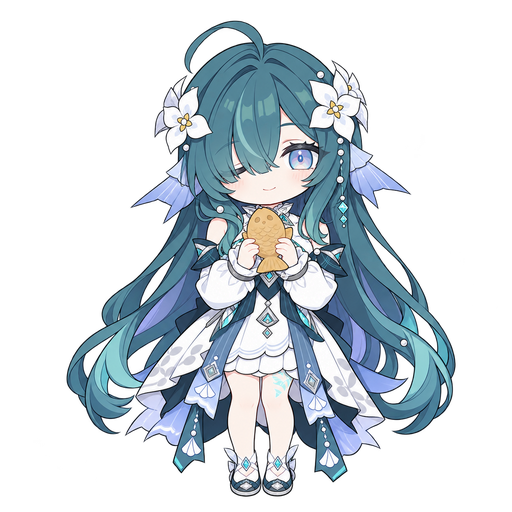

# StarPie 桌宠素材

由 [Star-Pie 组织](https://github.com/Star-Pie)托管，SoftBlack42 维护。素材独立下载，不随主程序或桌宠插件安装包携带。

<!-- PET-ASSETS:START -->
当前提供 **4** 套桌宠形象。每套包含常驻、眨眼、点击反馈、悬空拖动和八方向姿态，共 12 张 512×512 透明 PNG。

| 形象 | 预览 | 单独下载 |
| --- | --- | --- |
| 大肥鱼 |  | v1.0.1（待发布） |
| 沃雅妮莎 &#183; 鱼形点心 |  | v1.0.0（待发布） |
| 星绫 |  | v1.0.1（待发布） |
| Stocking |  | v1.0.0（待发布） |
<!-- PET-ASSETS:END -->

## 下载与使用

[历史四套素材合集（不再自动更新）](https://github.com/Star-Pie/StarPie-DesktopPet-Assets/releases/download/pets-2026.10.10.1/StarPie-DesktopPet-Assets-2026.10.10.1.zip) · [SHA-256 校验](https://github.com/Star-Pie/StarPie-DesktopPet-Assets/releases/download/pets-2026.10.10.1/SHA256SUMS.txt)

单独包解压后，在 StarPie「管理桌宠 → 导入文件夹」选择解压目录，再选择形象并使用。合集需选择其中的角色子文件夹，例如「大肥鱼」，不选择合集最外层。当前插件不直接导入 ZIP。

需要支持该 12 状态 PNG 格式的桌宠插件和匹配的主程序。桌宠插件 0.1.6 正式版要求 SDK 1.11，可在 StarPie v1.8.0-beta.7 的官方插件市场安装。本仓库只提供素材，不包含主程序或插件。

## 初期试用

目前用于桌宠插件的早期功能试用，先验证导入、形象切换、悬空拖动和轮盘方向联动。大肥鱼仅更新名称与说明，蓝鲸女仆原有图片不变；星绫图片与已有 v1.0.1 下载包相同。历史迭代草稿、参考原图和废弃方案不重复收入合集。

## 维护与自动发布

- 每组素材放在 `pets/<目录>/`，`asset-info.json` 是名称、ID、版本和公开发布标志的唯一声明来源。新增目录无需手动维护 catalog 或展示表。
- PR 自动校验全部素材并测试公开/草稿包；合并到 `main` 后自动为新增素材或升级版本创建独立 Release。
- 独立标签为 `pet-<id>-v<version>`，每个 Release 仅上传该组 ZIP 和 `SHA256SUMS.txt`。首次运行将迁移当前四套素材；旧的集中 Release 与历史合集不删除。
- 发布成功后机器人在同一个提交中更新仓库的 `catalog.json` 和上方三列表格。catalog/README 不作为 Release 附件。名称和版本读取 `asset-info.json`，预览使用 `idle.png`。
- 不覆盖旧版本。PNG、asset-info.json 或包内 README 变更时必须提升素材版本；`frame-sha256.json` 也须与 PNG 同步。`publishable=false` 的素材只校验，不公开发布或展示。
- 在 Actions 手动运行 **Validate and release pet assets**，`dry_run` 默认开启：只构建并上传预览 Artifact，不创建 Release、不提交或推送。首次接入时先查看 PR 自动上传的 dry-run 预览，再合并到 `main`。工作流进入默认分支后，也可选择功能分支手动 dry-run；只有 `main` 允许正式发布。
- 正式运行需要允许 `GITHUB_TOKEN` 的 `contents: write`，且 `main` 的保护规则允许该机器人提交。若推送失败，先修复权限再重跑；已发布且校验一致的包会复用，不强推或覆盖资产。
- 工作流会校验 ZIP 的尺寸、透明度、源图片哈希及发布资产哈希；草稿失败可恢复，已发布同名包不一致则停止。

本地验证（PowerShell 7.2+ / Windows）：

```powershell
./tools/Update-PetCatalog.ps1 -OutputDirectory dist/validation
./tools/Test-PetAssets.ps1 -CatalogPath dist/validation/catalog.json
./tools/Test-AssetPackages.ps1 -OutputDirectory dist/package-tests -AllowPrivateDraft
./tools/Test-ReleaseWorkflow.ps1
./tools/Publish-PetAssets.ps1 -DryRun
```

单独打包可继续使用 `./tools/Pack-PetAssets.ps1 -PackId <素材ID>`。dry-run 输出只在 `dist/` 中，不改写仓库文档；正式 workflow 在所有候选发布成功后才写回两份文件。
